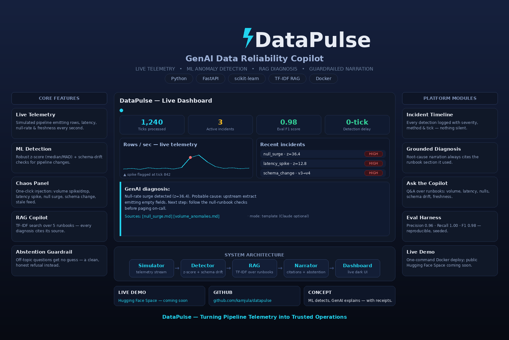
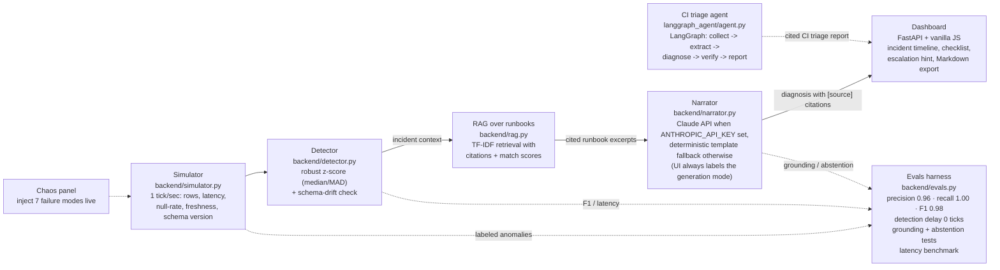

# ⚡ DataPulse — GenAI Data Reliability Copilot


[](https://github.com/kamjula/datapulse)

**ML detects, GenAI explains.** A live data-pipeline watchdog where an ML
anomaly detector flags telemetry issues and a GenAI copilot writes the
root-cause diagnosis — grounded in a runbook library, with citations and an
eval harness that measures it.

## Why this exists

Data downtime is expensive, and most "AI observability" demos are black
boxes. DataPulse makes the whole loop inspectable — detection, retrieval,
diagnosis, and the evals that check each step:

```
telemetry ──► ML detection ──► RAG over runbooks ──► GenAI diagnosis
(robust z-score    (citations,          (abstains instead of
 + schema-drift)   abstention)          hallucinating)
```

## Features

- **Live pipeline simulator** — emits rows, latency, null-rate, freshness,
  schema version every second (seeded, reproducible).
- **ML anomaly detection** — robust z-score (median/MAD, immune to baseline
  contamination) + discrete schema-drift check. (An IsolationForest layer
  was evaluated and removed — ablation showed zero added value;
  see `backend/baseline_report.md`.)
- **Chaos panel** — inject 7 failure modes live: volume spike/drop, latency
  spike, null surge, schema change, stale feed, duplicate surge. Detection delay: **0 ticks**.
- **GenAI root-cause narration** — incident context + retrieved runbook
  excerpts → concise diagnosis with `[source]` citations. Claude API when
  `ANTHROPIC_API_KEY` is set, deterministic template fallback otherwise
  (the UI always labels which mode produced the text).
- **Abstention guardrail** — off-topic questions get "not in the runbooks"
  instead of a hallucinated answer.
- **Copilot Q&A** — ask about pipeline failures in plain English, answered
  from the runbooks.
- **Eval harness** (`backend/evals.py`) — detection precision/recall/F1 per
  anomaly, detection delay, narration-grounding checks, abstention test,
  latency benchmark.
- **Copilot eval harness** (`backend/llm_evals.py`) — grades the copilot's
  answers for citation accuracy, groundedness, and abstention: 10 answerable
  questions (citation accuracy 1.00, groundedness 10/10) plus 4 unanswerable
  questions (abstention 3/4). The one miss is documented, not tuned away — see
  the harness docstring.
- **CI triage agent** — LangGraph `StateGraph` (`langgraph_agent/`) that
  reads a failing CI log, retrieves the matching runbook, and produces
  a cited, verified triage report — or abstains when nothing matches.
  Deterministic retrieval, no LLM in the loop: 8/8 cases correct,
  8/8 answers verified against the cited runbook.

## Evaluation Results — Seeded Synthetic Data

| anomaly | tick-recall | detection delay |
|---|---|---|
| volume_spike | 1.00 | 0 ticks |
| volume_drop | 1.00 | 0 ticks |
| latency_spike | 1.00 | 0 ticks |
| null_surge | 1.00 | 0 ticks |
| schema_change | 1.00 | 0 ticks |
| stale_feed | 1.00 | 0 ticks |
| duplicate_surge | 1.00 | 0 ticks |

Overall: **precision 0.96 · recall 1.00 · F1 0.98** · all narrations cite a
runbook and label their generation mode · abstention holds.

## Copilot & CI Agent Evals — Reproducible Runs

### Copilot answers (`backend/llm_evals.py`)

Run without an API key, so the narrator is in its deterministic template
mode: these numbers measure retrieval, citation, and abstention — not
Claude's wording.

| question set | result |
|---|---|
| 10 answerable questions | citation 10/10 = 1.00, groundedness 10/10 |
| 4 unanswerable questions | abstention 3/4 = 0.75 |
| gate | PASS (groundedness perfect, citation ≥ 0.90, abstention ≥ 0.75) |

One known miss, kept visible on purpose: "How do I tune a Kafka partition
count?" shares one generic word ("count") with a runbook, so TF-IDF scores
it above the weakest real question — a score threshold alone cannot
separate it without also rejecting a genuine question. See the docstring
in `backend/llm_evals.py`.

### CI triage agent (`langgraph_agent/`)

A LangGraph `StateGraph` — collect → extract → diagnose → (retry) →
verify → report — that reads a failing CI log, retrieves the matching
runbook, and ships a cited triage report. Retrieval is deterministic
(no LLM in the loop), so the eval is reproducible. If the first pass
abstains and a PR diff is available, the graph retries once with the
diff's file names widening the query before giving up.

| check | result |
|---|---|
| 8 synthetic failing logs, one per runbook | category accuracy 8/8 = 1.00 |
| answers verified against the cited runbook | 8/8 |
| complete node-by-node traces | 8/8 |
| unrelated log | abstains, PASS |

## Quickstart

```bash
python3 -m venv .venv && source .venv/bin/activate
pip install -r requirements.txt

# run the test suite
python -m unittest discover -s tests

# run evals (no API key needed)
python -m backend.evals

# copilot evals (template mode, no API key needed)
python -m backend.llm_evals

# CI triage agent evals (no API key needed) — the agent has its own
# requirements, install those first or the import fails
pip install -r langgraph_agent/requirements.txt
cd langgraph_agent && python evals.py
pytest  # the agent's own unit tests
cd ..

# start the live demo
uvicorn backend.app:app --port 8000
# open http://localhost:8000
```

Optional: `export ANTHROPIC_API_KEY=...` for Claude-powered narrations.

## Configuration

Detector sensitivity is tunable through environment variables — no code
changes needed to tighten or loosen anomaly detection:

| variable | default | what it does |
|---|---|---|
| `DATAPULSE_Z_THRESH` | `3.5` | Robust z-score cutoff per metric. Lower (e.g. `2.5`) = more sensitive, more alerts; higher (e.g. `5.0`) = quieter, fewer false positives. |

```bash
# example: stricter z-score layer for a noisy pipeline
DATAPULSE_Z_THRESH=5.0 uvicorn backend.app:app --port 8000
```

Invalid (non-numeric) values raise a `ValueError` at startup so a typo
never silently runs with the wrong sensitivity.

## Architecture



## 60-Second Demo Walkthrough

| sec | action | what you'll see |
|-----|--------|-----------------|
| 0–10 | Open the dashboard at http://localhost:8000 | Live charts for rows, latency, null-rate, freshness, and schema version. |
| 10–25 | Hit **null surge** in the chaos panel | The null-rate chart spikes. |
| 25–40 | Open the new incident card and the timeline | Detection fires at tick 0; the diagnosis cites the matching runbook, turns the fix into a 3-step checklist, and labels its generation mode. |
| 40–55 | Ask the copilot *"what do I do about a null surge?"*, then an off-topic question | A cited answer from the runbook library; the off-topic question gets an abstention instead of a guess. |
| 55–60 | Run `python -m backend.evals` | The eval table above: precision 0.96 · recall 1.00 · F1 0.98, abstention check passing. |

## Roadmap

- [ ] Postgres-backed incident history + weekly reliability report
- [ ] LLM-as-judge scoring for narration quality in evals
- [ ] Slack/PagerDuty webhook on high-severity incidents
- [ ] Real connector: plug in dbt / Airflow metadata instead of the simulator

## Stack

Python · FastAPI · scikit-learn · TF-IDF RAG · Claude API · LangGraph · vanilla JS dashboard

## Author

**Sravani Kamjula** · AI/ML Engineer  
[LinkedIn](https://www.linkedin.com/in/sravani-kamjula/) · [Portfolio](https://sravaniportfoli.netlify.app/) · [GitHub](https://github.com/kamjula)
