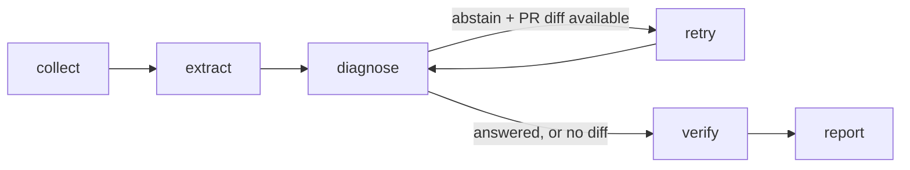

# DataPulse CI Triage Agent — LangGraph edition

This folder is the LangGraph edition of DataPulse's CI triage agent:
it reads a failing CI log, retrieves the matching runbook, and
produces a cited, verified triage report — or abstains when nothing
matches, instead of guessing.

I first built it as a small standalone repo to learn LangGraph
properly, then moved it in here so all of the CI triage work lives in
one place. The analyzer core (`ci_analyzer.py`, `rag.py`, `runbooks/`)
is vendored from DataPulse's own CI analyzer so this folder still runs
on its own. The agent layer (`agent.py`) is a LangGraph `StateGraph`.

## How the graph works



- **collect / extract** — count the log lines, pull out the error lines
  that carry the failure signal (platform boilerplate stripped).
- **diagnose** — TF-IDF retrieval over a curated runbook library
  (8 failure patterns). Every answer cites the runbook it came from.
- **retry (conditional edge)** — if the first pass abstains and a PR
  diff is available, the graph loops back and retries once with the
  diff's file names widening the retrieval query.
- **verify** — re-reads the cited runbook and checks the suggested
  cause/fix is actually in it. Ungrounded diagnoses do not ship.
- **report** — assembles the triage report. Every node appends to a
  trace in the graph state, so a run is inspectable step by step.

There are no LLM calls in the loop: diagnosis is deterministic
retrieval, which keeps the eval reproducible run after run.

## Eval results (real runs)

```
category accuracy:          8/8 = 1.00
verified (of answered):     8/8
complete traces:            8/8
abstention on unrelated log: PASS
unit tests:                 3 passed
```

The eval set is 8 hand-written synthetic logs, one per runbook pattern,
plus one unrelated log the agent must abstain on (`eval_cases.py`).

## Run it

```bash
cd langgraph_agent
python -m venv .venv && source .venv/bin/activate
pip install -r requirements.txt
python demo.py     # one failing log through the graph, with its trace
python evals.py    # the eval above
pytest             # unit tests
```

## Layout

| File | What it is |
|---|---|
| `agent.py` | The LangGraph StateGraph: nodes, conditional retry edge, trace |
| `ci_analyzer.py` | Retrieval diagnosis over the runbook library (from DataPulse) |
| `rag.py` | TF-IDF runbook retrieval (from DataPulse) |
| `runbooks/` | 8 curated CI failure-pattern runbooks |
| `evals.py` / `eval_cases.py` | End-to-end eval harness + labelled cases |
| `demo.py` | One-log demo with the node-by-node trace |
| `tests/` | Pytest suite (accuracy, abstention, retry edge) |
